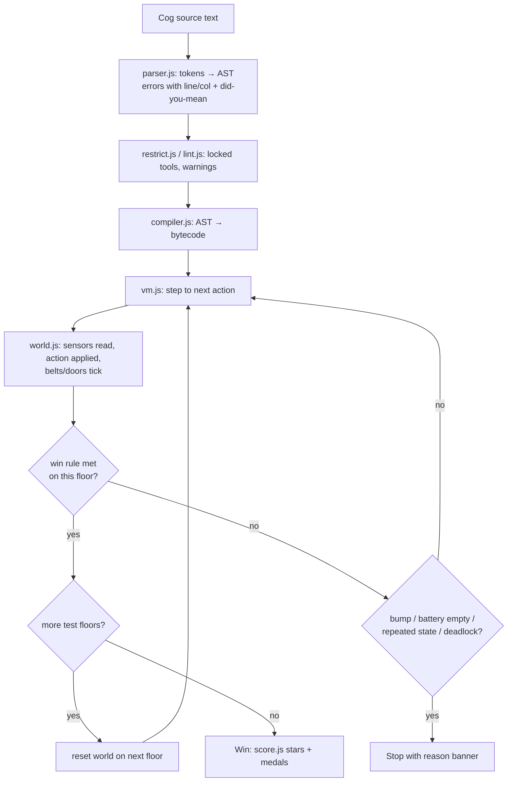
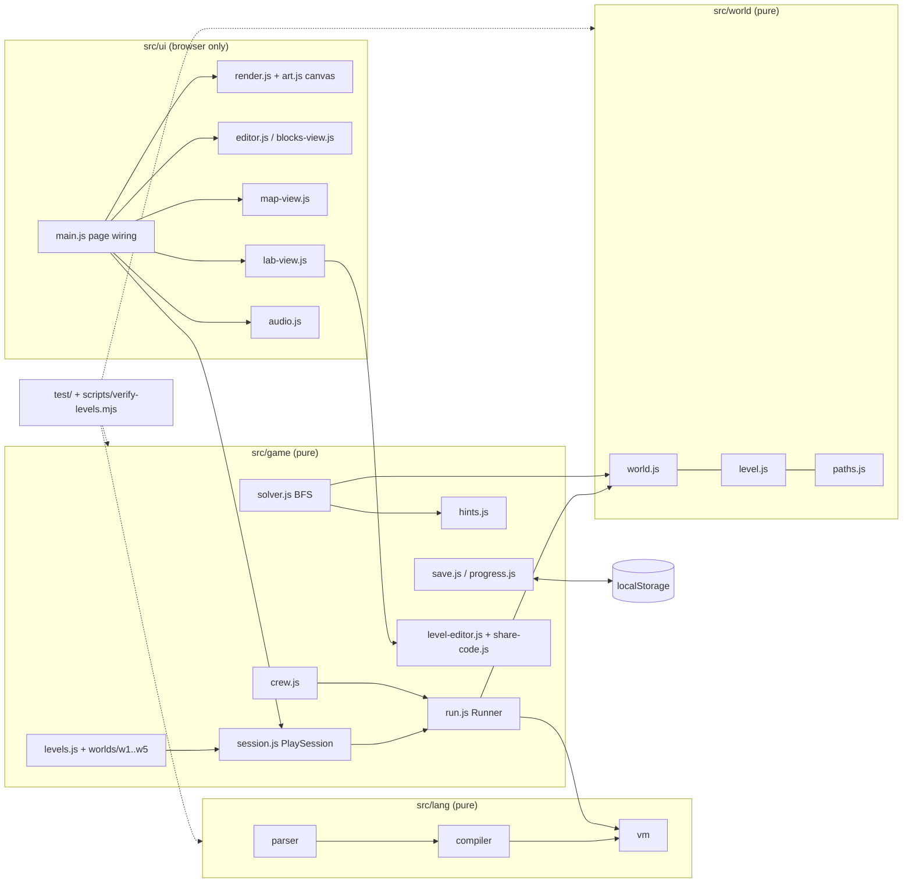
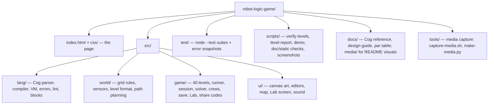

# Night Shift at Ferrolab

An original browser puzzle game. You program **Pip**, a small maintenance robot
working the night shift in the Ferrolab robotics factory, using **Cog** — a tiny
line-based command language — to solve grid puzzles. It has 40 levels in 5
worlds that each teach one robotics/CS idea (sequencing, sensing, loops,
conditionals, functions, state machines, path planning, cooperation), a step
debugger, a level editor (the Lab) with share codes, medals, hints, sound and
saved progress.


*Level 1-6 "Restock Run", played by the real game in headless Firefox: each
frame runs one more command of the shipped solution (36 steps, unrolled from
its `repeat 4`).*

**Docs:** [Cog language reference](docs/cog-reference.md) ·
[Level design guide](docs/level-design.md) · [Tick order](docs/ticks.md) ·
[Par table](docs/par-table.md). In the game, **? Help** (or the `?` key)
shows a quick reference of every command, sensor and key.

## Run it
No build step, no dependencies. ES modules need to be served over HTTP:

```sh
timeout 600 python3 -m http.server 8000   # then open http://localhost:8000
```

## Test it
Requires Node 18+.

```sh
node --test test/                 # parser, VM, world, runner, debugger, errors, every level's solution, solver
FUZZ_SEED=7 FUZZ_N=3000 node --test test/fuzz.test.js   # longer fuzz run with another seed
node scripts/check-static.mjs     # browser files/imports exist and parse
node scripts/check-docs.mjs       # doc links/anchors/paths valid; every Cog word documented + in-game help
node scripts/verify-levels.mjs    # proves every level/floor solvable (BFS optimum, crew joint search; --quick ~15 s)
node scripts/demo.mjs             # scripted terminal walkthrough: one level per world, share code, solver proof
node scripts/level-report.mjs     # per-world table: optimum, par, solution steps/size, battery, new commands (--md for Markdown)
UPDATE_SNAPSHOTS=1 node --test test/errors.test.js   # regenerate error-message snapshots
scripts/screenshots.sh            # headless-Firefox smoke shots -> .tmp/shots/ (optional)
```
Error-message wording is pinned by `test/snapshots/errors.snap.txt`; after an
intentional change, regenerate it and review the diff.

Dev URL parameters (handy for scripted screenshots): `?level=N` opens level N
(position in the full list: 1–8 World 1, 9–16 World 2, … 33–40 World 5); `?id=proto-8` opens
any level by id, including the old prototype fixtures (every tool unlocked);
`&code=...` (URL-encoded) loads that program; `&run=1` takes one step,
`&run=all` runs it instantly (finished before the first paint); `&solve=1` runs
the level's known solution; `&bp=2,5` sets breakpoints; `&mode=blocks` opens
the block editor; `&floor=3` watches test floor 3; `&map=1` opens the map;
`&hint=1` / `&hint=2` opens the text / route hint; `&cb=1` turns on R/Y/B paint labels;
`&settings=1` opens the settings menu; `&help=1` opens the help dialog.
Dev URLs ignore level locks; with no parameters the game starts on the map. `scripts/screenshots.sh
blocks calib` takes only the named shots.

## Playing


*The factory map after winning 1-1 and 2-1: stars per level, locks, Continue.*

The game opens on the **factory map**: one card per world with a tile per
level (stars earned, 🔒 when locked), total stars, a **Continue** button and
**Reset progress…**. Levels open in order, but up to two unsolved levels are
open at once, so one stuck puzzle never blocks you; a level you've won always
stays open.
**▦ Map** (or the M key, outside the editor) opens the map; Esc or M goes back.
The Level picker in the top bar still jumps anywhere that is open.

**💡 Hint** (or H, outside the editor) shows the level's text hint; press it
again to **show a route**: dots on the board along an optimal winning plan
found by the solver for the floor you are watching (if the search is too big,
the shortest drive to the next target instead). Crew levels have text hints
only. The first level of each world opens with a short story intro; winning
the last one adds the world's outro to the result banner. Accessibility: the
**R/Y/B** option in ⚙ Settings prints letters on painted floor tiles
(colour-blind aid, saved), every button shows a visible keyboard focus ring,
and `prefers-reduced-motion` turns off tweening and banner animation.

| Route hint (solver plan, R/Y/B labels) | Watching test floor 3 of 2-8 |
|---|---|
|  |  |


*The Lab: palette, board, level settings, known solution and share code box.*

**✎ Lab** (or open `index.html#lab`) is the level editor: pick a palette tool
(floor, wall, goal, part, bin, paints, belts, plate, door, robot — click a robot
again to turn it), click or drag on the board, set name/brief/size/win rule/
gripper/battery, add extra test floors, and write the known solution (one tab
per robot for crews). Undo/Redo (Ctrl+Z / Ctrl+Y). **Test-play** runs the
solution on every floor; **Share** only unlocks after a winning test-play since
the last edit; it then makes a **share link** (`index.html?code=FL1.…`, also
copied to the clipboard). Paste a code or link into the Share code box and
press **Import** (or just open the link) to load it as a new draft; it is
test-played at once. Codes are URL-safe base64 of the level JSON with a
version (`FL1`) and an FNV-1a checksum (`src/game/share-code.js`). **Save** keeps levels in a local
library (`ferrolab.custom` in localStorage, up to 50). Esc returns to the game.

Pick a level, write Pip's program, then **Run** (Ctrl+Enter; becomes Pause),
**Step** one action at a time (Ctrl+Shift+Enter), **Stop** where it is, or
**Reset** to the start (Esc). Speed goes from Slow to Instant and is remembered.
The running line is highlighted in the editor; errors get a red gutter mark and
the offending text is selected. A banner reports the result and offers the next
level after a win. Tab / Shift+Tab indent, Enter keeps indentation.

**Saving:** progress lives in one versioned localStorage record,
`ferrolab.save` (`src/game/save.js`): best record per level, drafts,
breakpoints, settings (speed, editor mode) and the last level opened. Saves
from before Day 11 (loose `ferrolab.best.*`, `stars.*`, `draft.*`, … keys) are
imported once and left in place. A damaged save is copied to
`ferrolab.save.bad` and a fresh one started; a save written by a newer version
is never overwritten; if storage is full or blocked the game keeps going and
the map says progress isn't being saved.

**Sound:** all sound is synthesized in the browser with WebAudio (no audio
files): footsteps, turn chirps, a thud on a bump, grab/drop/deliver blips, a
chime when a breakpoint pauses, a fanfare plus one chime per star on a win,
a falling buzz on a failure, and a low ambient factory hum. The topbar has
🔊 (mute), a volume slider and a **Hum** switch; all three are saved in the
settings. Sound starts after the first click or key press (browser autoplay
rules), pauses while the tab is hidden, and at Turbo/Instant only bumps and
results are voiced. Without WebAudio the game simply stays silent.

**Blocks:** the **Text / Blocks** switch above the editor shows the same
program as blocks (choice remembered). Click a tile in the tray to add it after
the selected block (or into an empty loop), or drag tiles and blocks into the
gaps; edit counts, conditions and function names in place; × or Delete
removes, Alt+↑/↓ moves, F9 sets a breakpoint (red dot on the block). The tray
only offers what the level has unlocked. Text stays the single source of
truth: every block edit is written back as tidy Cog text, so drafts,
breakpoints, the debugger and the running-block highlight work the same in
both modes. Switching to blocks tidies the layout (indentation, spacing) but
never moves a line; a program that doesn't parse stays in text mode with the
error shown.

**Test floors (World 2 on):** a level can come with extra floors, the same
job on different layouts. The buttons above the board pick which floor you
watch. A run only counts as a win if the program also wins on every other
floor (checked instantly when the watched run wins); otherwise the banner
says "Calibration failed", names the floor and the reason, and offers
**Watch floor N**. Stars are always scored on floor 1.

**Debugging:** click a line number (or press F9 on a line) to set a
breakpoint (red dot). Run pauses *before* that line executes (the line gets a
red band); Resume or Step continue past it. **Step over** (F10) is Step, but a
function call runs to completion in one go; **Step out** (Shift+F11) finishes
the current function and pauses right after it returns. While a run is in
progress the debugger panel lists the call stack (innermost first, with the
line each function was called from) and every active `repeat` block with its
line and pass ("pass 2 of 4"). Breakpoints are saved per level and still
pause step over / step out. A Memory column lists the program's registers and
their current values.

**Memory (registers):** `set n 3`, `add n 1`, `sub n k` change a register
(all start at 0, at most 8 per program, names can't clash with functions or
keywords). Memory ops take no step. Conditions can compare: `n == 3`,
`n != k`, `<`, `>`, `<=`, `>=`, combined with `not`/`and`/`or` and sensors.
Levels unlock them with the `memory` block; lint warns about a register that
is written but never read. They also appear as block-editor tiles.

**Functions:** whenever the program has `def`s, a Functions panel under the
editor lists each one with its line; click it to jump to the definition. During
a run it shows how many times each was called and which are running right now
(`running ×3` for recursion). Before running, the status line shows warnings
that don't stop the program: a function that is never called (or only calls
itself), empty blocks, `repeat 1`. Recursion works (e.g. `def go` / `if not
goal` / `move` / `go`), up to 64 nested calls; past that the error names the
function, or the pair of functions calling each other.

**Medals:** besides stars, each win earns a medal for **steps** and one for
**size**: 🥇 gold at or under par, 🥈 silver within 1.5× par, 🥉 bronze for any
win. The best value of each is saved per level (old saves: a kept par star
counts as gold, a plain win as bronze); medals show in the result banner and
the map tile tooltip.

**Par & stars:** each level has a par for **steps** (World 1: the fewest
possible, found by the BFS solver; levels with test floors: the steps of the
best *general* program on floor 1, never below the solver's optimum) and **size** (statements in the shortest
known program). Finishing earns ★, matching each par earns another. The two
pars often need different programs (1-8: the nested repeat is small, the
fastest route is longer to write), so each par star is kept once earned and
they add up across runs: meet the step par in one run and the size par in
another for ★★★. The best record is saved per level and shown on the map, in
the level picker and under the goal.

**Look:** the factory floor is pixel art drawn entirely in code (16 art pixels
per tile, scaled by whole numbers): steel floor plates with grates and bolts,
walls in 3/4 view with pipes, charging-pad goals, purple bins, gear parts, and
Pip with four facing sprites. Pip glides between tiles, hops when turning and
lurches when bumping a wall; with `prefers-reduced-motion` it snaps instead.

## Cog in 30 seconds
Full reference: [docs/cog-reference.md](docs/cog-reference.md).
```
# comments start with #
move 3            # also: left right grab drop wait
repeat 4
  move
  right
end
while clear and not goal
  move
end
if wall
  left
elif clear_right
  right
else
  wait
end
def hop           # functions: define anywhere at top level, call by name
  move
  left
end
hop
```
Sensors: `clear`, `wall`, `clear_left`, `clear_right` (range finders), `goal`,
`item`, `holding`, `bin` (tile / gripper), `red`, `yellow`, `blue` (floor colour
under Pip), `scan` (path planner: true when the tile ahead is one step
closer, by shortest path, to the current target — a bin while holding a part,
else the nearest part, else a goal pad; locked until World 4), `signal` (crews:
some signal is pending). Combine with `not`, `and`, `or`, parentheses.

Crews (several robots, each with its own program) talk with signals:
`send NAME` raises signal NAME (no step), `wait NAME` stands still until one is
pending and then uses it up (plain `wait` still just waits one step). Signals
count up. If every running robot is waiting and nothing moves, the run stops
with a **deadlock** message naming who waits for what. Locked until World 5.

Mistakes get a friendly message with line, column and a caret, plus a hint:
```
Line 2, col 6: unknown sensor 'yelow' — did you mean 'yellow'?
 2 |   if yelow
   |      ^^^^^
```
| Step debugger paused at a breakpoint (text) | Same program in the block editor |
|---|---|
|  |  |

*Level 1-6 with a breakpoint on line 5 (`drop`): current line, call stack and
state are shown while the robot waits.*

How a program runs, from text to a win (or a clear stop reason):



Runs stop with a clear reason when Pip bumps a wall, recurses more than 64
calls deep, loops without acting, repeats exactly the same situation (provable
infinite loop), or uses up the 2000-step battery.

## Level format (v1)
Levels are plain JSON-compatible objects (`src/world/level.js` validates them,
fills defaults and round-trips JSON):
```js
{ id: 'proto-8', name: 'Round Trip', brief: 'Shown to the player.',
  map: ['#######',
        '#G>.oB#',
        '#######'],
  win: ['deliver', 'reach'],   // or 'reach' | 'collect' | {type:'deliver', count:2}
  capacity: 1,                 // parts Pip can carry (1..9)
  maxSteps: 2000,              // battery
  tools: { actions: [...], sensors: [...], blocks: ['repeat','while','if','def'] },
  solution: 'move 2\ngrab\n…', hint: 'optional',
  par: { steps: 9, size: 5 },  // optional
  floors: [[...map rows...]] } // optional extra test floors (up to 5), same rules
```
**Crew levels** have 2–4 robot starts on the map (numbered in reading order)
and use `solutions: ['…', '…']` (one program per robot) instead of
`solution`; optional `robots: [{ name: 'Bolt', tools: {...} }, …]` names each
robot and can give it its own tool list. Every test floor must have the same
number of robots. Dev fixture: `?id=proto-11` (add `&solve=1&steps=4` to watch
a run in progress).
Map legend: `#` wall, `.` floor, `G` goal pad, `B` bin, `o` part, `r y b`
coloured floor, `> v < ^` Pip's start and facing, `N E S W` conveyor belts,
`_` pressure plate, `D` door (open while any plate holds Pip or a part). Belts
and doors update after every action in a fixed order — see
[`docs/ticks.md`](docs/ticks.md). Win rules: **reach** (stand on
a pad), **collect** (no parts left on the floor), **deliver** (parts dropped into
bins, all or `count`); a list means all at once. `tools` restricts the commands
on a level; using a locked one gives a positioned error. Validation catches
unreachable goals/parts/bins, unknown fields, bad counts, oversize maps, etc.

## Levels
Levels are grouped into worlds (`src/game/levels.js` → `WORLDS`, `LEVELS`).
- **World 1 "Boot Sequence"** (`src/game/worlds/w1.js`, 8 levels, no sensors):
  1-1 Wake-Up Call (`move N`), 1-2 Locker Corner (turns), 1-3 About Face
  (turning around), 1-4 Stairwell (`repeat`), 1-5 Loose Bolt (`grab`/`drop`),
  1-6 Restock Run (a job inside a repeat), 1-7 Low Battery (battery = the
  fewest possible steps, so turns matter), 1-8 Junction Sweep (nested repeat).
- **World 2 "Sensor Calibration"** (`src/game/worlds/w2.js`, 8 levels, 3
  test floors each): 2-1 Sensor Check (`while not bin`), 2-2 Corner Probe
  (`clear`, `goal`), 2-3 Scattered Bolts (`if item`), 2-4 Cable Duct
  (`elif`/`else`, `clear_right`), 2-5 Paint Codes (red/blue turns in an open
  room), 2-6 Parts Shuttle (whiles inside a repeat), 2-7 Locker Sweep
  (`clear_left`, `while holding`), 2-8 Calibration Run (everything at once).
  2-1 is a delivery rather than "reach the pad" on purpose: reaching a pad
  ends the run even mid-`move N`, so `move <longest>` would beat every floor.
- **World 3 "Assembly Line"** (`src/game/worlds/w3.js`, 8 levels, functions
  then memory registers): 3-1 Pallet Stairs (`def`), 3-2 Pillar Loop (a
  sensing routine run round a pillar), 3-3 Odometer (count out, walk back —
  no bin sensor), 3-4 Zigzag Relay (a register toggles the next turn: a state
  machine), 3-5 Return Trip (counted fetch in a `def`), 3-6 Every Third Mark
  (counter that resets), 3-7 Floor Select (read a number off the floor, use it
  as a distance), 3-8 Last Call (fetch until empty, a flag register ends the
  loop). Counting levels lock the `bin` sensor and the state-machine levels
  lock wall sensors, so remembering is the only way.
- **World 4 "Maze Wing"** (`src/game/worlds/w4.js`, 8 levels, 3 test floors
  each): 4-1 Right-Hand Rule (wall following), 4-2 Lost Bolts (a full
  wall-following sweep), 4-3 Left-Hand Wing (mirrored, right sensor locked),
  4-4 From the Stacks (wall following in a `def`, fetch and return), 4-5 Hold
  the Heading (Pledge algorithm: a register counts turns; 20-step battery),
  4-6 Planner Online (`scan` unlocks; mazes with loops), 4-7 Shortest Delivery
  (scan + gripper), 4-8 Night Inventory (deliver all, then dock, 120-step
  battery). `test/world4.test.js` checks that the solver agrees on every floor
  and that the weaker strategy each level replaces really fails.
- **World 5 "Swarm Floor"** (`src/game/worlds/w5.js`, 8 crew levels): two
  robots (Pip, Bolt) in 5-1 Hold the Door, 5-2 Round Trip, 5-3 Bucket
  Brigade, 5-4 Door Swap; three robots (plus Cog) in 5-5 Token Ring, 5-6
  Doorstop (a part on a plate), 5-7 Relay Line (two hand-off tiles), 5-8
  Night Shift. `test/world5.test.js` checks every floor wins at par, that
  every robot is needed, and that signal-free versions fail.
  
  *5-1 Hold the Door: Pip and Bolt each run their own program and use signals.*
- The Day 1–4 prototypes are no longer in the level list; they stay in
  `PROTOTYPES` / `ALL_LEVELS` as test fixtures.


*From `node scripts/level-report.mjs`: per level, the BFS solver's optimum
steps (dots), the par, the shipped solution's steps, and its size. Gaps between
dot and bars are levels where a general (sensing) program must cost extra steps.*

`test/levels.test.js` checks per world that every solution wins, tools unlock
in order (nothing learned is taken away; each new command is used), the
level's idea is really used (e.g. nested repeat on 1-8, repeat beats the flat
program), and that 1-7's battery equals the optimum found by the BFS solver
(`src/game/solver.js`, which also proves every level solvable). It also
checks every World 1 par: steps equal the solver's optimum, size equals the
stored solution's, and solutions trigger no warnings. `test/world1-play.test.js` plays
World 1 through `PlaySession` like the page does: every level wins with the
size star and offers the next level, ★★★ is reachable on every level, common
first mistakes (short, overshooting into a wall, wrong turn, locked command)
give a clear banner, and briefs only show unlocked commands.
`test/world2.test.js` checks World 2: solutions win on every floor, pars, tools
unlock in order and get used, **the best fixed route for any one floor fails
another floor** (so sensing is really needed), solutions win on 360 seeded
random floors (6 generators × 60), and the test-floor rules in `PlaySession`.
`test/world3.test.js` checks World 3 the same way (floors, pars, fixed routes
fail, memory really needed, 240 seeded random floors).
`test/save.test.js` covers saving with a fake storage (reload, legacy import,
corrupt / newer / full / blocked storage, reset) and the map (unlock rule,
playing every solution in order keeps the next level open, totals, Continue).
`test/audio.test.js` checks the sound module against a stub AudioContext
(every cue builds valid nodes routed through the master gain, no context
before unlock, mute/volume/hum, rate limit and voice cap, no WebAudio → silent)
and that `SoundCues` follows a real `PlaySession` (steps, bump, breakpoint,
win fanfare with one chime per star, silent reset).
`test/code-mode.test.js` covers Text ⇄ Blocks: every solution switches to blocks
unchanged and still wins, and can be built from its level's own tile tray. Par format:
`par: { steps, size }` (optional, validated by `level.js`).

## Layout
Architecture: pure logic modules (tested by `node --test`) under a thin
browser layer.



Repository map:



- `src/lang/` — parser (source → AST), compiler (AST → bytecode), steppable VM,
  `errors.js` (positions, "did you mean", caret formatting), `lint.js`
  (non-fatal warnings, `analyze()` = parse + lint without running)
- `src/game/score.js` — par comparison and stars
- `src/game/save.js` — versioned save (`SaveStore`, legacy import, `MemoryStorage`
  fake for tests); `src/game/progress.js` — map model, unlock rule, Continue target
- `src/world/` — grid world: map format, sensors, actions, win rules;
  `paths.js` — BFS distance fields, A* routes over poses (turns cost 1), `scan`
- `src/game/` — level data by world (each with a tested solution), BFS
  `solver.js` (fewest-action wins), `Runner` (world + VM,
  win check, step budget, infinite-loop detection) and `PlaySession`
  (run/pause/step/stop/reset/speed state machine), shared by tests and UI
- `src/world/level.js` — level format v1: validation, defaults, JSON, goal text
- `src/ui/art.js` — pure art data/helpers: sprite strings, layout, wall
  autotile masks, tile hash, easing, `Animator` (tweens Pip between ticks)
- `src/ui/` — browser code: canvas renderer (art drawn in code), code editor
  (gutter + line band; pure logic in `editor-model.js`), block editor
  (`blocks-view.js` over the pure `src/lang/blocks.js`; mode logic in
  `code-mode.js`), world map (`map-view.js`), synthesized sound (`audio.js`:
  cue table, event → cue mapping, `Sound` engine with an injectable
  AudioContext) and page wiring
- `src/game/level-editor.js` — editor reducer (undo/redo); `custom-levels.js` —
  test-play gate + custom library; `lab-tools.js` — palette click → action;
  `src/ui/lab-view.js` — the Lab screen
- `src/game/hints.js` — hint tiers, route hint (solver plan → trail), story beats
- `test/` — `node --test` suites; `scripts/` — check scripts

## Status

**Day 30 of 30: finished (v1.0).** All 40 levels in 5 worlds are built and
proved solvable (solver + shipped solutions on all 92 test floors), with a
text and block editor, step debugger (breakpoints, step over/out, call stack,
memory, crew view), medals and stars, hints with solver routes, story beats,
the Lab level editor with `FL1` share codes and `?code=` links, synthesized
sound, saved progress and settings, the
[Cog reference](docs/cog-reference.md), the
[level design guide](docs/level-design.md) and an in-game **? Help** dialog.
`node scripts/demo.mjs` is a scripted walkthrough; the
[release checklist](docs/release-checklist.md) lists the final checks.
Screenshots are in `docs/`; README media in `docs/media/` is regenerated
with `tools/capture-media.sh` then `.venv/bin/python tools/make-media.py`
(needs Firefox, matplotlib, Pillow).

Known gaps: Share/Import buttons are unit-tested and screenshot-checked but
were never clicked by a person in a real browser; win confetti is not visible
in headless screenshots; 4 crew floors in World 5 are proved by their shipped
solution, not by a solver optimum (search capped).
